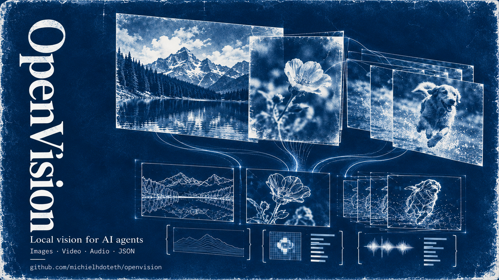

# Open Vision



**Agents are blind by default. Open Vision gives them eyes and ears.**

A local-first CLI that lets AI agents inspect video, understand speech, and retrieve time-stamped evidence. Local providers need no API key or cloud account; optional hosted providers are available when configured. Open Vision sends nothing anywhere unless you choose a remote provider or source URL.

```
openvision observe video.mp4
openvision ask video.mp4 "what color is the car?"
openvision transcribe video.mp4
```

## Why?

AI agents can read code, but they can't watch a video, read a screen recording, or hear a meeting. Open Vision fixes that. It extracts keyframes, transcribes audio, and builds a structured timeline that agents can actually reason about.

Works from an agent tool call, a shell script, or any framework that can run a CLI.

## Install

```bash
pip install -e .
```

That's it. yt-dlp is included for YouTube URLs. Speech-model weights are installed separately. No GPU required (but it helps with vision and diarization).

**Optional extras:**

```bash
uv sync --extra diarize     # Local pyannote Community-1 + CUDA PyTorch (Windows/Linux)
uv sync --extra segment     # Ultralytics segmentation support
```

Transcription uses a locally installed Parakeet or Whisper model. Install Parakeet with `openvision install parakeet`. Optional pyannote Community-1 diarization requires the `diarize` extra, Hugging Face access approval, and `hf auth login`. Use `--no-transcribe` or `--no-diarize` to skip those stages. Segmentation is on demand with `--segment` (or follows the selected processing profile); SAM 3 requires its package and gated weights. The CLI reports unavailable stages instead of pretending they ran.

## 30-Second Start

```bash
# Check that everything works
openvision status

# Analyze a video
openvision observe video.mp4

# Ask a specific question
openvision ask video.mp4 "is there a dog in this video?"

# Transcribe with speaker labels
openvision transcribe video.mp4 --diarize

# Works with YouTube too
openvision observe "https://youtube.com/watch?v=..."
```

## What It Does

**Observe** -- Extracts keyframes from video, analyzes each with a vision model, and builds a cross-modal timeline (visual + audio). Returns a structured summary.

Use `observe --read-text` to ask the VLM to quote clearly legible text in sampled frames. This is VLM-based reading, not a separate OCR engine; uncertain or obscured text should remain marked as uncertain.

**Ask** -- Targeted question about video content. "What color is the car?" returns a direct answer with evidence frames.

**Transcribe** -- Speech-to-text using Parakeet (default, fast, runs on CPU) or Whisper. Supports speaker diarization.

**Segment** -- Text-prompt object segmentation. "person" returns masked regions with bounding boxes.

**Video memory** -- Successful video `observe` runs automatically index their available evidence into the local SQLite database and report the indexing result in `stages.memory`. `--memory` requests denser long-video coverage (about one visual sample per 30 seconds, capped at 300 frames), transcription/diarization, and sampled segmentation. The database keeps a whole-video root, five-minute sections, and thirty-second evidence windows; speech, visual notes, speakers, and frame/mask references remain distinct and time-grounded.

**Track** -- Frame-by-frame object tracking across a video.

**Probe** -- Video metadata: duration, resolution, FPS, codec, estimated processing cost.

## For Agents

### Vision-capable agents (recommended)

If your agent can read images:

```bash
openvision observe video.mp4 --raw-frames --transcribe --json
```

This skips the local VLM and returns frame paths + audio timeline. Your agent does the visual reasoning.

### Text-only agents

```bash
openvision observe video.mp4 --json
```

Open Vision runs a local VLM (LM Studio, Ollama, llama.cpp) and returns structured observations.

### Streaming pipelines

```bash
openvision observe video.mp4 --jsonl --transcribe
```

One JSON event per line. Agents and pipelines can consume results incrementally.

## Features

### Long-video memory

```bash
# Run a higher-coverage analysis. Its transcript and visual evidence join the
# same local index used by every other successful observe run.
openvision observe lecture.mp4 --memory

# Discover indexed videos, inspect the hierarchy, search across all sources,
# or ask about one source video.
openvision memory status
openvision memory sources
openvision memory outline --video lecture.mp4
openvision memory search "when does the speaker demonstrate the setup?"
openvision memory search "red dial" --video lecture.mp4
openvision memory ask lecture.mp4 "What happens during the setup demonstration?"
```

`observe` saves run artifacts and indexes the evidence it produced in `~/.openvision/runs/runs.db` (or the configured cache directory). `--save-observations` is separate: it writes a human-readable Markdown note under `~/.openvision/observations/videos/`; it is not required for database search. `memory search` works across all indexed sources; add `--video` to filter. `memory sources` lists what is available, and `memory outline` shows its time hierarchy. `memory ask VIDEO QUESTION` retrieves matching intervals and asks the configured VLM to verify them against stored evidence frames; it needs a reachable VLM. Retrieval uses SQLite full-text search, not embeddings. Speaker labels are associated with nearby visual events by time, but are **not** asserted to identify a visible person.

Raw-frame mode is an agent handoff: its transcript can be indexed, but its images have no searchable visual descriptions until a vision-capable agent analyzes them. Use normal `observe` (or `observe --memory`) when you want visual evidence indexed for later retrieval. Re-running an unchanged observation uses its cache and refreshes its memory index; `--force` recomputes it.

| Feature | Command |
|---------|---------|
| Visual analysis | `observe video.mp4` |
| Targeted Q&A | `ask video.mp4 "question"` |
| Read visible text with the VLM | `observe video.mp4 --read-text` |
| Speech-to-text | `transcribe video.mp4` |
| Speaker labels | `transcribe video.mp4 --diarize` |
| Automatic memory indexing | `observe video.mp4` |
| Higher-coverage long-video memory | `observe video.mp4 --memory` |
| Browse indexed videos | `memory sources` |
| Memory retrieval | `memory search "query"` / `memory ask video.mp4 "question"` |
| Object segmentation | `segment video.mp4 "prompt"` |
| Object tracking | `track video.mp4 "prompt"` |
| YouTube support | `observe "https://..."` |
| Time windowing | `observe video.mp4 --start 1:30 --end 2:00` |
| Contact sheets | `observe video.mp4 --grid` |
| HTML viewer | `observe video.mp4 --viewer` |
| Frame selection report | `observe video.mp4 --report` |
| Keep audio | `observe video.mp4 --keep-audio` |
| Cookie auth | `observe "url" --cookies-from-browser chrome` |
| Inline DNN inference | `observe video.mp4 --dnn-model yolov8n.onnx` |
| Streaming JSONL | `observe video.mp4 --jsonl` |
## Agent integration

The CLI is the stable agent interface. Prefer JSON for one-shot tool calls and JSONL when consuming incremental events:

```bash
openvision observe video.mp4 --json
openvision memory search "the presenter changes the setting" --json
```

## Backends

Open Vision auto-detects what's running. No config needed.

**Vision models:** LM Studio, Ollama, llama.cpp, OpenAI, Groq, Together AI, vLLM

**Speech-to-text:** Parakeet TDT 0.6B v3 (default, INT8, ~640MB, CPU), Whisper (optional)

**Hardware:** Works on CPU. GPU (CUDA) is faster for VLM inference. Parakeet runs efficiently on CPU.

## Configuration

Defaults work out of the box. Customize via `config/default.yaml` or environment variables:

```bash
export OPENVISION_CONFIG=my_config.yaml
```

Three processing modes:

| Mode | Best for |
|------|----------|
| `fast` | Quick inspection, low resource usage |
| `balanced` (default) | Most workflows |
| `detailed` | High-value clips, maximum detail |

All data lives in `~/.openvision` (override with `OPENVISION_HOME`).

## Contributing

```bash
git clone https://github.com/michielhdoteth/openvision.git
cd openvision
pip install -e ".[test]"
pytest tests/ -v
```

Architecture: `cli/` (Typer commands) -> `core/` (video, audio, sampling, streaming) -> `providers/` (VLM + STT backends) -> `storage/` (SQLite cache, paths). See `AGENT_GUIDE.md` for the full agent integration guide.

## License

MIT
